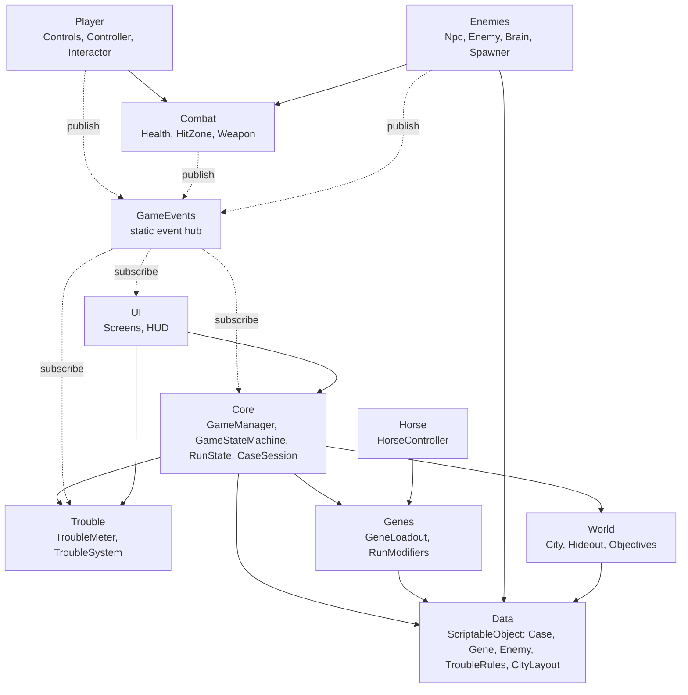
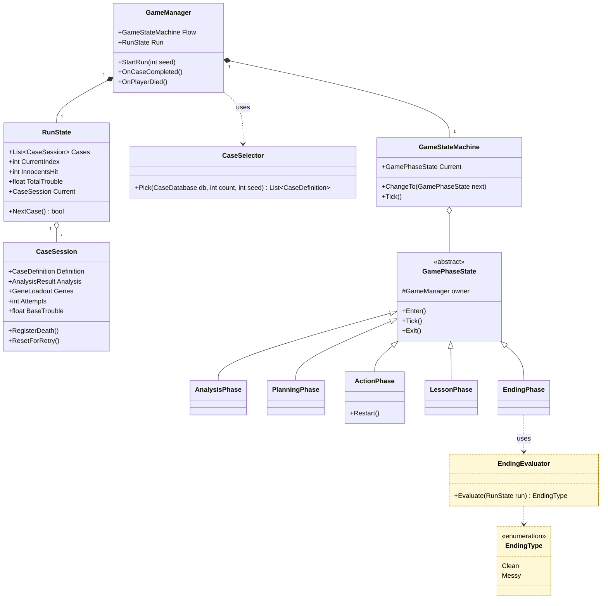
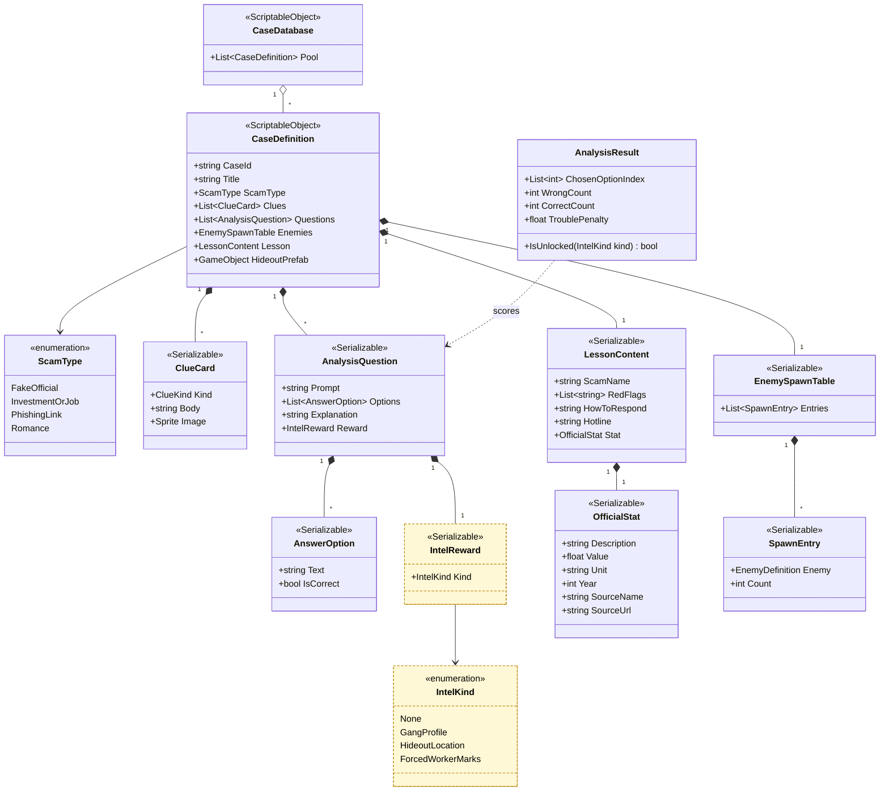
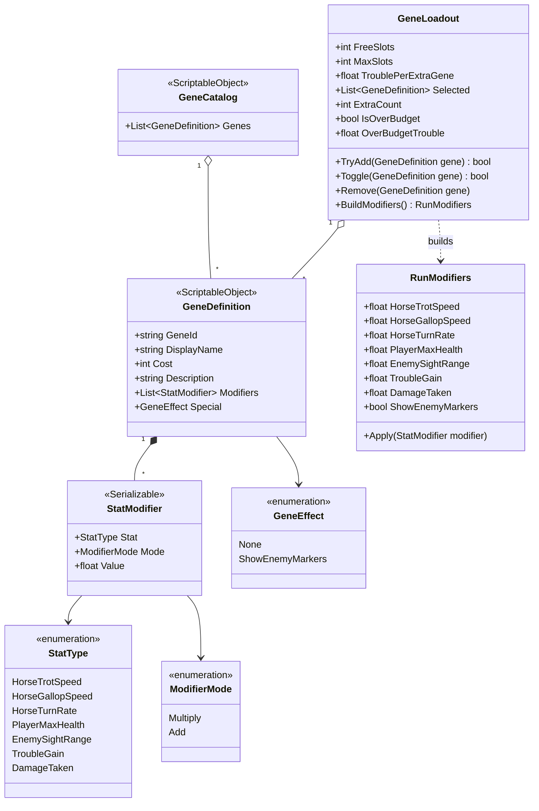
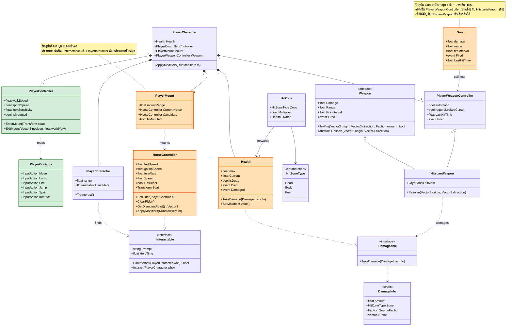
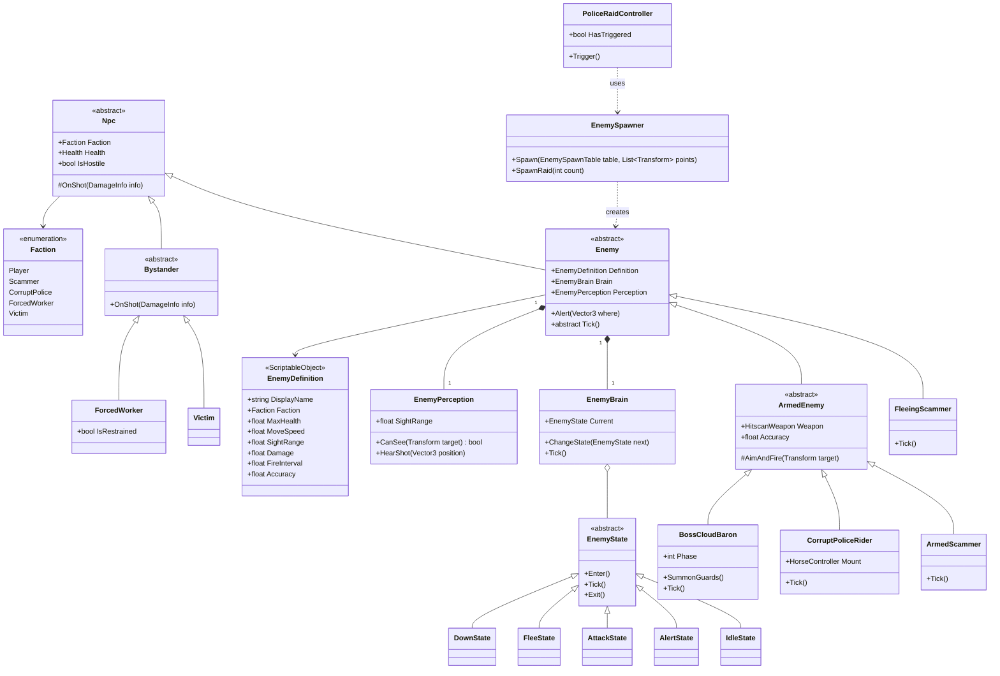
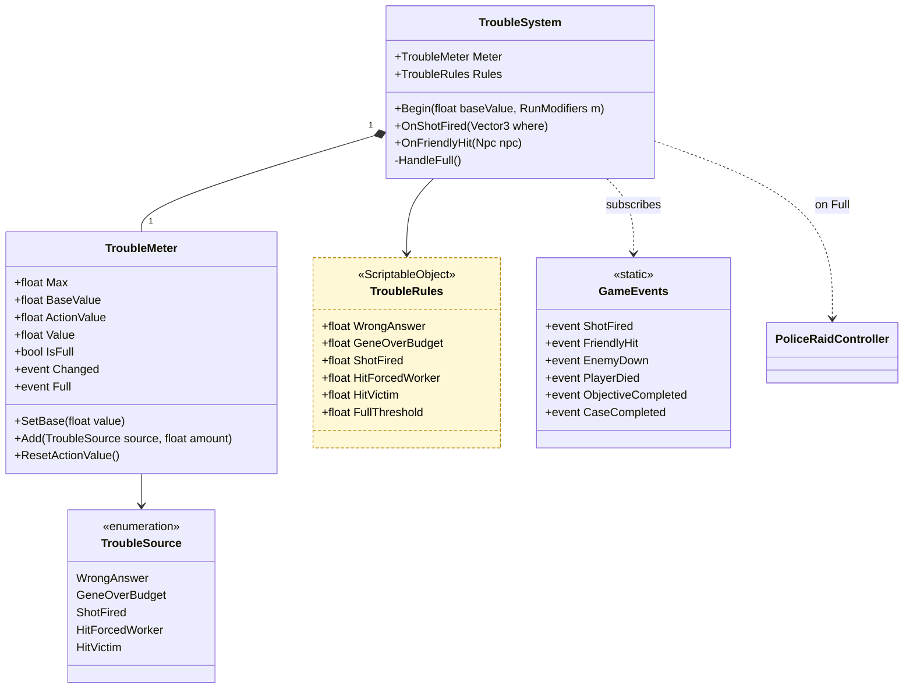
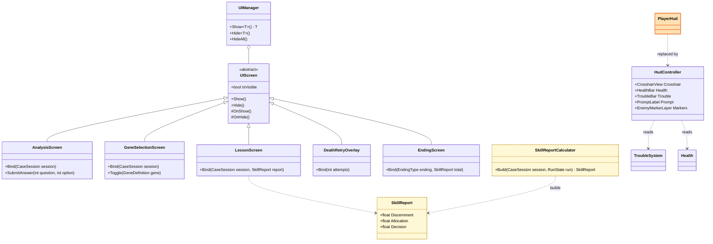
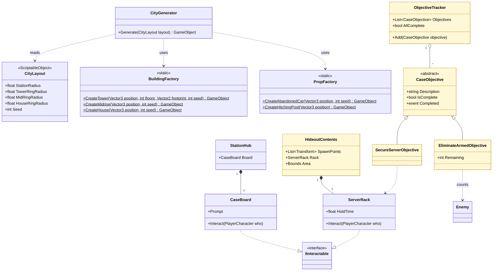
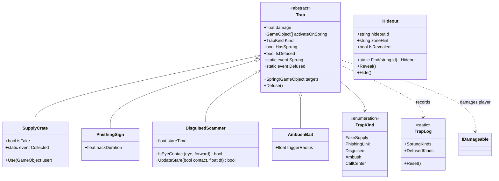

# Class Diagram: Scammer No Scamming

เวอร์ชัน 0.1 (draft) · 2026-10-23 · Unity 6000.3.6f1 · namespace `ScammerNoScamming`

เอกสารนี้เป็นแบบโครงสร้างโค้ดของเกมทั้งหมด ใช้เป็นหลักอ้างอิงร่วมกันของทีม ถ้าโค้ดกับเอกสารไม่ตรงกัน ให้แก้เอกสารก่อน แล้วค่อยแก้โค้ดตาม (หรือกลับกัน แต่ต้องบันทึกเหตุผลในหัวข้อ "ประวัติการเปลี่ยนแปลง" ท้ายไฟล์)

ดูเป็นภาพ (PNG/SVG) ได้โดยเปิด [diagrams/index.html](diagrams/index.html) ด้วยเบราว์เซอร์ ไม่ต้องมีปลั๊กอิน ภาพสร้างจากไฟล์นี้ ถ้าแก้ไฟล์นี้ต้องสร้างภาพใหม่

แผนภาพเขียนด้วย Mermaid ดูได้บน GitHub, VS Code (ปลั๊กอิน Markdown Preview Mermaid Support) หรือ https://mermaid.live

## 1. วิธีอ่านเอกสาร

| สีในแผนภาพ | ความหมาย |
|---|---|
| เขียว | **มีโค้ดแล้ว** ตรงกับเอกสาร (ระบบ Player ที่ทำไว้ใน `Assets/Scripts`) |
| ส้ม | **มีโค้ดแล้ว แต่ต้องแก้/แยกส่วน** ตามเอกสารนี้ |
| ขาว | **ใหม่** ยังไม่มีโค้ด |
| เหลืองเส้นประ | **รอตัดสินใจ** ยังโครงไว้เฉยๆ อย่าเพิ่งลงมือเขียนจริง |

เครื่องหมาย `+` public, `-` private, `#` protected ชื่อ `Foo~Bar~` หมายถึง generic เช่น `List~Bar~`

## 2. หลัก OOP ที่ใช้ในเกมนี้

| หลักการ | ใช้ตรงไหน |
|---|---|
| **Encapsulation** | ค่าสถานะ (เลือด, Trouble) เป็น property อ่านอย่างเดียว เปลี่ยนค่าผ่านเมธอดเท่านั้น เช่น `Health.TakeDamage`, `TroubleMeter.Add` |
| **Inheritance** | ลำดับชั้น NPC: `Npc` → `Enemy` / `Bystander` → ชนิดเฉพาะ; `GamePhaseState`, `UIScreen`, `CaseObjective` มีลูกหลายชนิด |
| **Polymorphism** | เรียก `enemy.Tick()`, `objective.IsComplete`, `phase.Enter()` โดยไม่ต้องรู้ชนิดจริง; `IDamageable` ให้ผู้เล่น ศัตรู และเป้าทดสอบรับดาเมตแบบเดียวกัน |
| **Composition** | ตัวละครประกอบจาก component เล็กๆ (`Health`, `HitZone`, `Weapon`, `EnemyPerception`) ไม่สร้างลำดับชั้นลึกเกินจำเป็น (แบบของ Unity) |
| **Abstraction** | `IInteractable`, `IDamageable` เป็น interface; ข้อมูลเนื้อหาแยกเป็น `ScriptableObject` (ไม่ฮาร์ดโค้ดคดี ยีน ตัวเลข) |

กฎการพึ่งพา (dependency rules):

1. `Data` (ScriptableObject) ไม่ขึ้นกับใคร คนอื่นอ่านจากมัน
2. `Combat`, `Player`, `Enemies` **ไม่เรียก** `Trouble` หรือ `UI` โดยตรง ให้ประกาศผ่าน `GameEvents` แล้วให้ `TroubleSystem` กับ UI รับฟังเอง
3. ลอจิกของเกมแยกจากหน้าจอ: `UIScreen` แสดงผลและรับคลิก แต่ตัดสินใจโดย `Core`
4. ตัวเลขปรับสมดุล (ดาเมต, ค่า Trouble, ความเร็ว) อยู่ใน ScriptableObject เท่านั้น

## 3. ภาพรวมแพ็กเกจ



## 4. Game flow และการเลือกคดี

`GameManager` ถือ `GameStateMachine` ซึ่งสลับ phase ตามลำดับ: **Analysis → Planning → Action → Lesson** ต่อคดี และเมื่อครบทุกคดีจะเข้า `EndingPhase`



กติกาของ `CaseSession` ตามที่ตัดสินใจแล้ว:

- ผู้เล่นตาย → `RegisterDeath()` แล้วเล่น **ขั้นลงมือซ้ำ** ยีนและคำตอบวิเคราะห์คงไว้
- `BaseTrouble` (จากคำตอบผิดและยีนเกินโควตา) **คงไว้ตอนเล่นซ้ำ** ส่วนค่า Trouble จากขั้นลงมือ **รีเซ็ต** (`ResetForRetry()` + `TroubleMeter.ResetActionValue()`)
- `EndingEvaluator` รอตัดสินใจ: ข้อเสนอคือแบ่ง `Clean`/`Messy` จาก Trouble รวมกับ `InnocentsHit`

## 5. ข้อมูลเนื้อหา (ScriptableObject)

เนื้อหาคดีทั้งหมดเป็นข้อมูล ไม่ใช่โค้ด ทำให้เพิ่มคดีใหม่โดยไม่แก้โปรแกรม และสุ่มจากพูลได้



หมายเหตุ:

- `IntelReward` / `IntelKind` รอตัดสินใจ (ขั้นวิเคราะห์ปลดล็อกข้อมูลหรือไม่) ใส่ไว้เป็นช่องว่าง `None` ได้ ไม่กระทบส่วนอื่น
- `OfficialStat` เก็บตัวเลขทางการ 1 ตัว พร้อมแหล่งและปี **ยังไม่มีค่า** ต้องค้นและตรวจแหล่งก่อนกรอก
- `Hotline` และ `RedFlags` ต้องตรวจกับคำเตือนทางการก่อนใส่ ห้ามเขียนจากความจำ

## 6. ยีนและตัวปรับค่า (Genes)



ยีนทุกตัวอยู่ในรูป "รายการ `StatModifier`" ข้อดีข้อเสียจึงเป็นแค่ค่าบวก/ลบในรายการเดียวกัน ตัวอย่างจากคอนเซ็ปต์ (**ตัวเลขเป็นแค่ตัวอย่าง รอปรับตอนเล่นทดสอบ**):

| ยีน | ข้อดี | ข้อเสีย | ตัวปรับค่า |
|---|---|---|---|
| เร็ว | ควบเร็ว | เลี้ยวยาก | `HorseGallopSpeed ×1.25`, `HorseTurnRate ×0.75` |
| ทนกระสุน | เลือดเพิ่ม | ช้าลง | `PlayerMaxHealth ×1.5`, `HorseGallopSpeed ×0.85` |
| ดมตามรอย | เห็นศัตรูไกล | Trouble เพิ่มเร็ว | `Special = ShowEnemyMarkers`, `TroubleGain ×1.5` |
| ซ่อนตัว | ศัตรูเห็นยาก | ม้าเปราะ | `EnemySightRange ×0.5`, `DamageTaken ×1.5` |

**โค้ดจริง (2026-10-23, branch `feature/genes-traps-map`)**: กติกาที่ตัดสินใจแล้วคือ "ปกติ 2 ตัว สูงสุด 4 ตัว" จึงใช้จำนวนช่องแทน `Budget`/`Cost`: `GeneLoadout(freeSlots=2, maxSlots=4, troublePerExtraGene)` มี `ExtraCount`, `OverBudgetTrouble`, `Toggle()`; ยีน 4 ตัวสร้างได้จาก `GeneCatalog.CreateDefault()`; ม้าใช้คอมโพเนนต์ `HorseGenes.Apply(RunModifiers)` (ไม่แก้ `HorseController`) ซึ่งคูณจากค่าตั้งต้นเสมอ เล่นซ้ำแล้วไม่ทบ

สิ่งที่ต้องยืนยัน: "ม้าเปราะ" ในเอกสารต้นฉบับ ที่นี่ตีความเป็นผู้เล่นรับดาเมตมากขึ้น (`DamageTaken`) เพราะม้ายังไม่มีเลือด; กติกาจำนวนยีนตัดสินใจแล้ว (ปกติ 2 สูงสุด 4) แต่ค่า Trouble ต่อยีนที่เกินยังไม่กำหนด จึงเป็นพารามิเตอร์ `TroublePerExtraGene` (ค่าเริ่ม 20 ชั่วคราว); `GeneDefinition.Cost` ไม่ได้ใช้

## 7. Player, Horse และ Combat



สถานะโค้ดปัจจุบัน (`Assets/Scripts`):

| คลาส | สถานะ | ต้องทำ |
|---|---|---|
| `PlayerControls`, `PlayerController` | มีแล้ว ตรงกับเอกสาร | - |
| `PlayerMount` | มีแล้ว ต้องปรับ | ให้ทำงานคู่กับ `PlayerInteractor` / `IInteractable` |
| `HorseController` | มีแล้ว ต้องปรับ | เพิ่ม `ApplyModifiers`, ทำ `IInteractable` |
| `Health` | มีแล้ว ต้องปรับ | รับ `DamageInfo` (ตัวคูณจุดที่โดน), `Damaged` event, `SetMax` |
| `Gun` | มีแล้ว ต้องแยก | แยกเป็น `PlayerWeaponController` + `HitscanWeapon` |
| `PlayerHud` | มีแล้ว ย้ายไปแพ็กเกจ UI | ดูหัวข้อ 10 |
| `PlayerCharacter`, `PlayerInteractor`, `HitZone`, `DamageInfo`, `Weapon` | ใหม่ | - |

กติกาที่ตัดสินใจแล้ว: **ผู้เล่นมีเลือดและตายได้** เมื่อ `Health.IsDead` ผู้เล่นเกิด `GameEvents.PlayerDied` → `ActionPhase` เล่นขั้นลงมือซ้ำ; ดาเมตแยกจุด **หัว/ตัว/เท้า** ใช้ `HitZone.Multiplier` (ตัวคูณยังไม่กำหนด) ดังนั้น `HitscanWeapon.Resolve` ต้องหา `HitZone` ก่อน ถ้าไม่เจอให้ใช้ `Health` ตรงๆ

## 8. NPC และศัตรู

**โค้ดจริง (2026-10-23, รอบ 1) ต่างจากแผนภาพข้างล่าง**: ลำดับชั้นคือ `Character` (Health + Faction) → `PlayerCharacter` / `Npc` → `Enemy` (abstract) → `ShooterScammer` ยังไม่มี `EnemyBrain`/`EnemyState`/`EnemyPerception` แยกคลาส การรับรู้ (สายตา+เสียงปืน) และการลาดตระเวนอยู่ใน `Enemy` ตรงๆ และฝั่ง `Bystander` ยังไม่ทำ (จะเป็น `Civilian` ใต้ `Npc`) ยึดโค้ดเป็นหลักจนกว่าจะปรับแผนภาพ



ประเด็นสำคัญ:

- **ยิงผิดคน**: `Bystander.OnShot` (เหยื่อ/ลูกจ้างที่ถูกบังคับ) ประกาศ `GameEvents.FriendlyHit(npc, info)` ให้ `TroubleSystem` บวกค่า Trouble และ `RunState.InnocentsHit` นับเพิ่ม โดยไม่ต้องให้ `Bystander` รู้จัก Trouble
- `EnemyPerception.SightRange` = `EnemyDefinition.SightRange × RunModifiers.EnemySightRange` (ยีน "ซ่อนตัว")
- ศัตรู 3 แบบตามสโคป MVP: `FleeingScammer`, `ArmedScammer`, `CorruptPoliceRider` และบอส `BossCloudBaron` (ใช้ `ArmedEnemy` ร่วมกัน)
- `PoliceRaidController.Trigger()` เรียกเมื่อ Trouble เต็ม (ไม่ใช่เงื่อนไขแพ้) ตำรวจเทาบุกเข้าฉากเป็นศัตรูเพิ่ม
- **ชะตาของศัตรูเมื่อโดนยิง**: ใช้ระบบเลือด + ดาเมตแยกจุด เมื่อเลือดหมดเข้า `DownState` (รายละเอียดแอนิเมชัน/ล้ม/ตาย ยังไม่กำหนด)

## 9. ระบบ Trouble และ GameEvents

Trouble มี **สองถัง**: `BaseValue` (มาจากขั้นวิเคราะห์และยีน คงไว้เมื่อเล่นซ้ำ) กับ `ActionValue` (สะสมระหว่างลงมือ รีเซ็ตเมื่อเล่นซ้ำ) ค่าที่แสดงบนจอ = `BaseValue + ActionValue`



ที่ตัดสินใจแล้ว:

- Trouble เต็ม = **ตำรวจเทาบุก** ไม่ใช่เงื่อนไขแพ้
- แหล่งที่เพิ่ม Trouble: ตอบผิด, เลือกยีนเกินโควตา, ยิงเสียงดัง (ยิงปืน), ยิงผู้บริสุทธิ์
- เล่นซ้ำ: `BaseValue` คง, `ActionValue` รีเซ็ต

รอตัดสินใจ: **ตัวเลขใน `TroubleRules` ทั้งหมด** (ที่เคยเสนอ: ตอบผิด +10, ยิงปืน +1 ต่อนัด, ลูกจ้าง +15, เหยื่อ +25, ยีนเกิน +20) และเกณฑ์ย่อย (เช่น ลาดตระเวนที่ 50) จึงเก็บใน ScriptableObject เพื่อปรับโดยไม่แตะโค้ด

## 10. UI และหน้าสรุปทักษะ



- `PlayerHud` ปัจจุบันเป็น IMGUI แบบชั่วคราว (ครอสแฮร์ ข้อความขึ้น/ลงม้า) ให้แทนที่ด้วย `HudController` (uGUI) เมื่อเริ่มทำ UI จริง เพราะ IMGUI ไม่รองรับอักษรไทย
- `SkillReport` เสนอเป็น 3 แถบ (แยกแยะ / จัดสรร / ตัดสินใจ) เพื่อโชว์ว่าเกม "ฝึกทักษะแก้ปัญหา" ตามโจทย์ ยังเป็นข้อเสนอ ไม่ใช่ข้อสรุป
- `DeathRetryOverlay` แสดงเมื่อผู้เล่นตาย แล้วเรียก `ActionPhase.Restart()`

## 11. เมืองและเป้าหมายของด่าน (World)



- เมืองเป็นวงแหวน รัศมีราว 200 ม.: สถานี (0-30) → ตึกสูง (30-80) → อาคารทั่วไป (80-140) → บ้าน (140-200) สร้างจาก primitive ผ่าน `BuildingFactory`/`PropFactory` ตามที่ตัดสินใจ (ผสมกับเท็กซ์เจอร์จาก Codex)
- Interior เข้าได้บางอาคาร (สถานีเป็นอย่างน้อย) ยังไม่ออกแบบคลาสเฉพาะ ใช้ prefab ห้องเดียวต่อ `StationHub`
- **รอตัดสินใจ**: บทบาทของแผนที่ (ฮับอย่างเดียว หรือเมืองเดียวใช้ทุกคดี) และเงื่อนไขชนะของด่าน (ที่เสนอ: จัดการผู้ติดอาวุธ + กด E ค้างที่ตู้เซิร์ฟเวอร์) จึงโครง `Hideout` กับ `CaseObjective` ไว้ก่อน ถ้าเงื่อนไขชนะเปลี่ยน เพิ่มคลาสลูกของ `CaseObjective` ได้ โดยไม่แก้ส่วนอื่น

## 11.1 กับดักระหว่างทาง (Traps) และหลายรัง



- กับดักทุกอันต้องมีสัญญาณให้สังเกตก่อน (อาร์ตหรือพฤติกรรม) ดู PLAN.md หัวข้อ 4
- กับดักไม่รู้จัก Trouble/UI/ศัตรู: ระบบอื่นฟัง `Trap.Sprung`/`Defused` เอง, ศัตรูที่ซุ่มอยู่วางไว้ในฉากแบบปิดแล้วใส่ใน `activateOnSpring`
- `DisguisedScammer` มี `Health` ของตัวเอง (`RequireComponent`) ถ้าถูกยิงตายก่อน = Defuse; การสบตาต้องมองเห็นกันจริง (Linecast)
- ปุ่ม E ใช้ร่วมกับ `PlayerMount`: กับดักอ่านปุ่มใน `LateUpdate` และไม่นับการกดที่ทำให้ขึ้น/ลงม้า (`Trap.IsOnFootInteract`)
- `WeaponLock` (อยู่บนตัวผู้เล่น) ล็อกปืนตอนโดน Hack และปลดเฉพาะที่ตัวเองล็อก
- `PlayerLocator` หา `PlayerController` ครั้งเดียวแล้วเก็บไว้; ค่า static ทั้งหมดรีเซ็ตตอนเริ่ม Play (`RuntimeInitializeOnLoadMethod`)
- `PhishingSign` ล็อกปืนผู้เล่น `hackDuration` วินาที (ผลของการโดน Hack เป็นข้อเสนอ ยังไม่ยืนยัน)
- Call center gang ยังไม่มีโค้ด (ตัดได้ตาม PLAN.md)
- `Hideout` (โค้ดจริง) ดูแลตำแหน่งและการเปิดเผย ส่วนของภายในรัง (จุดเกิดศัตรู ตู้เซิร์ฟเวอร์) ในหัวข้อ 11 เปลี่ยนชื่อเป็น `HideoutContents` เพื่อไม่ให้ซ้ำ ยังไม่มีโค้ด และเงื่อนไขชนะเปลี่ยนเป็น Seal หลักฐานที่สถานีแล้ว (ดู CONTEXT.md); เมืองมีหลายรัง คดีอ้างด้วย `hideoutId`, ตอบถูกในขั้นวิเคราะห์ = `Reveal()` ขึ้นลำแสงเหนือรัง

## 12. โฟลเดอร์และการแบ่งงาน

```
Assets/Scripts/
  Core/       GameManager, GameStateMachine, GamePhaseState*, RunState, CaseSession, CaseSelector, EndingEvaluator
  Data/       CaseDatabase, CaseDefinition, EnemyDefinition, TroubleRules, CityLayout, ...
  Genes/      GeneTypes (StatType, StatModifier...), GeneCatalog, GeneDefinition, GeneLoadout, RunModifiers, HorseGenes
  Traps/      Trap, TrapLog, SupplyCrate, PhishingSign, DisguisedScammer, AmbushBait, WeaponLock, PlayerLocator
  Player/     PlayerControls, PlayerController, PlayerMount, PlayerInteractor, PlayerCharacter
  Horse/      HorseController
  Combat/     Health, HitZone, DamageInfo, IDamageable, Weapon, HitscanWeapon, PlayerWeaponController
  Enemies/    Npc, Enemy, ..., EnemyBrain, EnemySpawner, PoliceRaidController
  Trouble/    TroubleMeter, TroubleSystem
  World/      CityGenerator, BuildingFactory, PropFactory, StationHub, Hideout, ServerRack, Objectives
  UI/         UIManager, UIScreen*, HudController, SkillReport
  Dev/        PlayerSandbox (เครื่องมือทดสอบ ไม่ใช่ส่วนของเกม)
```

ข้อเสนอผู้ดูแลแต่ละแพ็กเกจ (ทีม 3 คน ยังไม่ได้ตกลง):

| แพ็กเกจ | ผู้ดูแลที่เสนอ |
|---|---|
| Core, Player, Horse, Combat, Enemies, Trouble, Genes | System (โปรแกรม) |
| World (การสร้างเมือง, prefab, เท็กซ์เจอร์, การนำเข้าอาร์ต) | Art Technical |
| Data (เนื้อหาคดี, ข้อความบทเรียน, ตัวเลขสมดุลร่วม), UI copy | Manager / Creative Art ร่วมกับ System |

## 13. สิ่งที่ยังรอตัดสินใจ (กระทบเอกสารนี้)

| # | เรื่อง | ส่วนที่ได้รับผลกระทบ |
|---|---|---|
| 1 | ขั้นวิเคราะห์ปลดล็อกข้อมูล (`IntelReward`) | หัวข้อ 5; `AnalysisPhase`, `Hideout`, UI |
| 2 | บทบาทของแผนที่ (ฮับ / ใช้ทุกคดี) | `Hideout`, `CityGenerator`, การวางฐาน |
| 3 | เงื่อนไขชนะของด่าน | `CaseObjective` และคลาสลูก |
| 4 | ตัวเลข Trouble, ตัวคูณดาเมตหัว/ตัว/เท้า, ค่ายีน | ScriptableObject เท่านั้น ไม่กระทบโครงคลาส |
| 5 | กติกาจำนวนยีน / ค่าปรับเกินโควตา | `GeneLoadout` |
| 6 | ชะตาศัตรูเมื่อเลือดหมด (ล้ม / ตาย / ถูกจับ) | `DownState`, แอนิเมชัน |
| 7 | ฉากจบ 2 แบบ ตัดสินจากอะไร | `EndingEvaluator` |
| 8 | ตัวเลขทางการ 1 ตัว | `OfficialStat` (ค่ายังว่าง) |

## 14. ประวัติการเปลี่ยนแปลง

| วันที่ | เวอร์ชัน | การเปลี่ยนแปลง |
|---|---|---|
| 2026-10-23 | 0.1 | ร่างแรกจากคอนเซ็ปต์ที่ตกลงแล้วและโค้ดระบบ Player ที่มีอยู่ |
